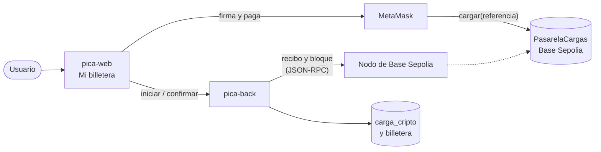
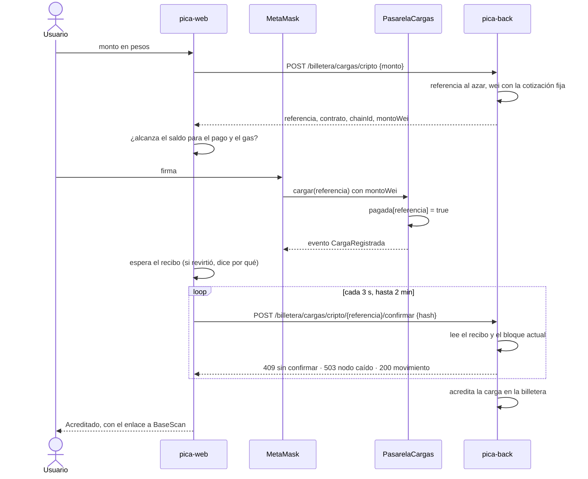

# Arquitectura de la pasarela de cargas

Cómo se carga saldo en PICA pagando con una wallet: qué hace cada pieza, por qué está armada así y de qué riesgos se cuida. El contrato está en este repo; el back y el front, en [pica-back](https://github.com/hydra-sip/pica-back) y [pica-web](https://github.com/hydra-sip/pica-web).

## Piezas

| Pieza | Qué hace | Qué no hace |
|---|---|---|
| **`PasarelaCargas`** (este repo) | Recibe el ETH de una carga, marca su referencia como pagada y emite `CargaRegistrada(referencia, pagador, monto)`. Guarda lo recaudado hasta que el dueño lo retira. | No sabe de pesos, de usuarios ni de la billetera. |
| **pica-back** | Crea la carga con su referencia y los wei a pagar, lee la transacción en la red y, si pagó esa carga, la acredita en la billetera. | No firma ni manda transacciones: solo lee. |
| **pica-web** | Conecta la wallet, muestra cuánto ETH se paga, llama a `cargar` y le pasa el hash al back hasta que acredita. | No decide si un pago vale: eso lo dice el back. |
| **MetaMask** | Firma y envía la transacción desde la cuenta del usuario. | — |

## Una carga, paso a paso

1. **Iniciar.** El back crea la carga `PENDIENTE` (tabla `carga_cripto`) con una referencia de 32 bytes al azar y los wei que hay que pagar, y le devuelve al front la referencia, la dirección del contrato, el chain id y los wei.
2. **Pagar.** El front chequea que el saldo de la cuenta cubra el pago más el gas estimado y llama a `cargar(referencia)` con esos wei. El contrato revierte si el monto es 0, si la referencia es `0x0`, si ya se pagó o si está en pausa.
3. **Esperar.** Con el hash, el front espera el recibo. Si la transacción revirtió, repite la llamada en ese bloque para leer el error del contrato y no la manda a acreditar.
4. **Confirmar.** El front le pasa el hash al back. El back lee el recibo por JSON-RPC y acredita solo si:
   - la transacción está minada y no revirtió;
   - tiene al menos 3 confirmaciones, contando su bloque;
   - entre sus logs hay un `CargaRegistrada` emitido por la dirección de la pasarela con la referencia de la carga;
   - el monto del evento es exactamente el que se fijó al iniciar;
   - ese hash no acreditó ya otra carga.
5. **Acreditar.** En una transacción de base, con la carga bloqueada, nace el movimiento `CARGA` con el hash como referencia externa y la carga pasa a `ACREDITADA`. Mi billetera muestra el movimiento con su enlace a BaseScan.

## Decisiones

### El contrato cobra en ETH; la cotización es del back

- **Contexto.** La billetera de PICA es en pesos y la red de prueba solo tiene ETH sin valor.
- **Decisión.** El usuario paga en ETH de Base Sepolia. El back convierte con una cotización fija (`app.cripto.wei-por-peso`, $10.000 = 0,0001 ETH) y fija los wei al iniciar la carga, así el monto no cambia entre que el usuario lo ve y lo paga.
- **Por qué.** Un oráculo de precios o una stablecoin agregan dependencias y riesgos que en testnet no aportan nada. El contrato queda simple: registra wei y no sabe de pesos.

### La referencia es un `bytes32` al azar que genera el back

- **Contexto.** El contrato tiene que poder decir qué carga se pagó sin saber de usuarios.
- **Decisión.** El back genera 32 bytes con `SecureRandom` y los guarda con la carga. En la cadena solo aparece la referencia, nunca el usuario ni el monto en pesos.
- **Por qué.** No se puede adivinar ni derivar de datos del usuario, y el contrato puede rechazar el segundo pago de la misma referencia (`pagada[referencia]`). Se descartó usar un id incremental, porque se podría predecir y además expone cuántas cargas hay.

### Se acredita leyendo el evento, no la transacción

- **Contexto.** Una wallet con smart account (MetaMask con transacciones delegadas, por ejemplo) manda el pago a través de otra dirección: el `to` y el `from` de la transacción no son la pasarela ni el usuario.
- **Decisión.** El back busca en los logs del recibo un `CargaRegistrada` cuya dirección emisora sea la pasarela.
- **Por qué.** Solo el contrato puede emitir un log con su propia dirección, así que el evento prueba el pago aunque la transacción venga de otro lado.

### Tres confirmaciones antes de acreditar

- **Contexto.** Una transacción recién minada puede salir de la cadena si hay una reorganización.
- **Decisión.** El back acredita recién cuando la transacción tiene 3 bloques, contando el suyo (`app.cripto.confirmaciones-minimas`). Antes contesta 409 `TRANSACCION_PENDIENTE`, y el front reintenta cada 3 segundos hasta 2 minutos. En Base Sepolia, 3 bloques son unos 6 segundos.
- **Por qué.** Es un margen razonable para una L2 de prueba sin hacer esperar al usuario. Si la red tarda más, el front avisa la demora y deja reintentar.

### Idempotencia en las tres capas

- **Contrato:** una referencia se paga una sola vez (`ReferenciaYaPagada`).
- **Base de datos:** la referencia y el hash son únicos en `carga_cripto`. Una transacción acredita una sola carga aunque haya pagado varias.
- **Back:** reconfirmar una carga ya acreditada con el mismo hash devuelve el mismo movimiento, sin volver a consultar la red. Con otro hash es 409 `CARGA_YA_ACREDITADA`. Dos confirmaciones al mismo tiempo se ordenan con un bloqueo de la fila.
- **Por qué.** El front reintenta y el usuario puede recargar la página: ningún reintento puede acreditar dos veces.

### El back solo lee la cadena

- **Decisión.** El back consulta el recibo y el bloque actual por JSON-RPC (`eth_getTransactionReceipt`, `eth_getTransactionByHash`, `eth_blockNumber`). No tiene claves ni firma transacciones. Si el nodo no contesta en 5 segundos o da error, responde 503 `RED_NO_DISPONIBLE` y el front reintenta.
- **Por qué.** El servidor no maneja ninguna clave privada que se pueda filtrar.

### La dirección del contrato vive en el back

- **Decisión.** El back la lee de `PASARELA_CARGAS_ADDRESS` y se la manda al front en cada carga, junto con el chain id.
- **Por qué.** Una sola fuente: si se redespliega el contrato, se cambia una variable y el front no queda apuntando al viejo.

### El front recupera las cargas pagadas sin acreditar

- **Contexto.** Si el usuario cierra la pestaña después de pagar, el back nunca recibe el hash y la plata queda en el contrato sin acreditarse.
- **Decisión.** Apenas tiene el hash, el front guarda la carga en el navegador, por usuario. Al volver a Mi billetera la confirma sola y la borra al acreditarse o si el back la rechaza.
- **Alternativa descartada, por ahora:** que el back recorra los eventos del contrato para reconciliar las cargas pagadas. Es más robusto, pero es otro proceso que mantener.

## Riesgos cubiertos

| Riesgo | Cómo se cubre |
|---|---|
| **Reentrancy** | `cargar` y `retirar` tienen `nonReentrant` (OpenZeppelin), y `retirar` sigue checks-effects-interactions: valida, emite el evento y recién después transfiere. Lo prueban `test_retirar_noPermiteReentrarDesdeElDestino` y `test_unaDevolucionNoPuedeReentrarEnCargar`. |
| **Una falla o un ataque en curso** | El dueño puede `pausar()` y los pagos revierten; los retiros siguen funcionando para poder sacar los fondos. |
| **Perder el control del contrato** | `Ownable2Step`: el nuevo dueño recién lo es cuando acepta. `renounceOwnership` siempre revierte, para que lo recaudado no quede sin nadie que lo retire. |
| **ETH enviado sin referencia** | `receive` y `fallback` revierten con `PagoSinReferencia`: todo lo que entra está asociado a una carga. |
| **Pagar dos veces la misma carga** | `pagada[referencia]` en el contrato y el hash único en el back. |
| **Una reorganización de la cadena** | Las 3 confirmaciones antes de acreditar. |
| **Pagar menos (o más) de lo pedido** | El back compara el monto del evento con los wei fijados al iniciar: si no coinciden, 400 `MONTO_NO_COINCIDE` y la carga sigue pendiente. |
| **Reusar el hash de otro pago** | El hash es único en `carga_cripto`: 400 `TRANSACCION_YA_USADA`. |
| **Confirmar la carga de otro usuario** | El back busca la carga por referencia y por el usuario de la sesión. |
| **Una transacción falsa o fallida** | El back lee el recibo de la red, no confía en lo que mande el front: sin recibo exitoso y sin el evento de la pasarela no hay acreditación. |
| **El retiro a una dirección que no acepta ETH** | `retirar` revierte entero (`TransferenciaFallida`), sin dejar el evento ni el saldo a medias. |

El análisis estático (Slither, en el CI) marca un solo hallazgo, informativo: `low-level-calls`, por el `call` con el que `retirar` transfiere. Es intencional: `transfer` y `send` limitan el gas a 2300 y fallan con destinos que son contratos, y el `call` está protegido por `nonReentrant`, por el orden checks-effects-interactions y por el chequeo de su resultado.

## Riesgos que se aceptan

- **Cotización fija.** No refleja ningún precio real: sirve para testnet, no para dinero de verdad.
- **Clave del dueño.** Vive en un keystore cifrado de Foundry en la máquina de quien despliega. No hay multisig ni timelock, porque para una red de prueba no se justifica.
- **Pagar la referencia de otro.** La referencia es secreta hasta que su dueño manda el pago; desde ahí se ve en el mempool y alguien podría pagarla antes. Si paga el monto exacto, la carga se le acredita igual al dueño, y la transacción del dueño revierte sin cobrarle más que el gas. Si paga otro monto, el back lo rechaza y la referencia queda trabada, porque el contrato no acepta un segundo pago: el usuario tiene que iniciar otra carga. Quien lo hace pierde su ETH y no gana nada.
- **Contrato no actualizable.** Un error se corrige desplegando otro contrato y cambiando `PASARELA_CARGAS_ADDRESS`. Las cargas pendientes del viejo se resuelven a mano.
- **Un pago que no llega a confirmarse.** Si el usuario paga desde otro navegador y nunca vuelve a Mi billetera, la carga queda pendiente y el ETH en el contrato. Hoy se resuelve a mano; la reconciliación desde el back sería la solución de fondo.
