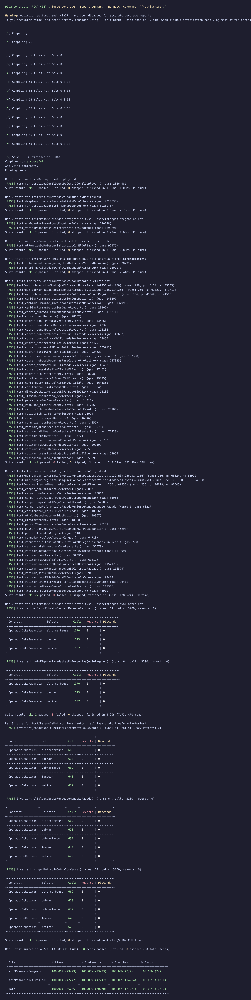
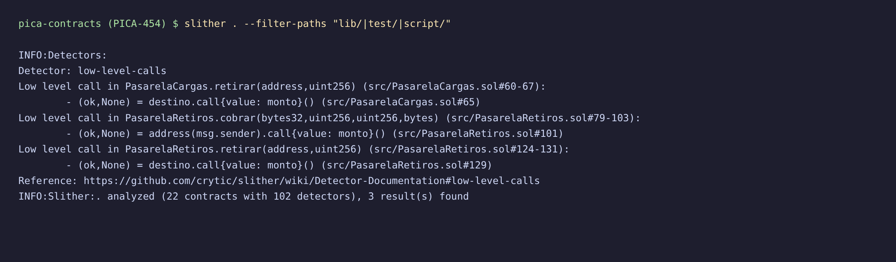

# pica-contracts

[](https://github.com/hydra-sip/pica-contracts/actions/workflows/ci.yml)

Contratos de la pasarela de PICA:

- **`PasarelaCargas`**: un usuario paga con ETH de prueba la carga de saldo que inició en la plataforma, y el contrato deja un registro verificable en la blockchain que el back usa para acreditar la carga en su billetera.
- **`PasarelaRetiros`**: el camino inverso. El usuario retira saldo a su wallet: el back firma un permiso y el usuario lo cobra en ETH desde su wallet. Ver [Interfaz de `PasarelaRetiros`](#interfaz-de-pasarelaretiros).

Red: Base Sepolia. Herramientas: [Foundry](https://getfoundry.sh), Solidity 0.8.38 y OpenZeppelin Contracts v5.7.0.

## Cómo funciona

1. El back genera la **referencia** de la carga (un `bytes32`) y la guarda como pendiente, con el monto en pesos.
2. El usuario llama a `cargar(referencia)` desde su wallet, enviando el ETH.
3. El contrato marca la referencia como pagada y emite `CargaRegistrada(referencia, pagador, monto)`.
4. El back lee ese evento en el recibo de la transacción, verifica que el monto sea el que fijó al iniciar la carga y, con 3 confirmaciones, la acredita.

El contrato registra el monto en wei y no sabe nada de pesos: la cotización y la verificación del monto esperado son del back.

El circuito completo (wallet, front, contrato, back y billetera), las decisiones de diseño y los riesgos que cubre están en [ARCHITECTURE.md](ARCHITECTURE.md).

## Interfaz de `PasarelaCargas`

| Función | Quién | Con el contrato pausado | Qué hace |
|---|---|---|---|
| `cargar(bytes32 referencia)` payable | cualquiera | revierte | Registra el pago y emite `CargaRegistrada` |
| `retirar(address destino, uint256 monto)` | dueño | funciona | Transfiere `monto` a `destino` y emite `FondosRetirados` |
| `pausar()` / `reanudar()` | dueño | — | Frena o vuelve a aceptar los pagos |
| `pagada(bytes32 referencia)` | cualquiera | — | Indica si la referencia ya se pagó |
| `transferOwnership` / `acceptOwnership` | dueño / nuevo dueño | — | Traspaso del contrato en dos pasos |
| `renounceOwnership()` | dueño | — | Siempre revierte: sin dueño, lo recaudado quedaría bloqueado |

Eventos:

- `CargaRegistrada(bytes32 indexed referencia, address indexed pagador, uint256 monto)`
- `FondosRetirados(address indexed destino, uint256 monto)`
- `Paused`, `Unpaused` y los del traspaso de dueño, de OpenZeppelin

Errores:

| Error | Cuándo |
|---|---|
| `MontoCero()` | Una carga o un retiro de 0 |
| `ReferenciaVacia()` | Una carga con la referencia `0x0` |
| `ReferenciaYaPagada(referencia)` | Una carga a una referencia que ya se pagó |
| `PagoSinReferencia()` | ETH enviado al contrato sin pasar por `cargar` |
| `DestinoInvalido()` | Un retiro a la dirección cero |
| `SaldoInsuficiente(saldo, monto)` | Un retiro mayor que el saldo |
| `TransferenciaFallida()` | El destino del retiro rechazó el ETH |
| `RenunciaNoPermitida()` | El dueño intenta renunciar al contrato |

Seguridad: `Ownable2Step`, `Pausable` y `ReentrancyGuard` de OpenZeppelin, y el patrón checks-effects-interactions en `retirar`. El contrato no es actualizable.

## Interfaz de `PasarelaRetiros`

1. El back descuenta el saldo del usuario y firma un permiso EIP-712 `Retiro(referencia, destino, monto, vence)` con la clave del **firmante**.
2. El usuario llama a `cobrar(referencia, monto, vence, firma)` desde la wallet de `destino`.
3. El contrato verifica la firma, que no se haya cobrado y que no haya vencido; marca la referencia, emite `RetiroCobrado(referencia, destino, monto)` y transfiere el ETH.
4. El back lee el evento y, con 3 confirmaciones, confirma el retiro.

| Función | Quién | Con el contrato pausado | Qué hace |
|---|---|---|---|
| `cobrar(bytes32 referencia, uint256 monto, uint256 vence, bytes firma)` | el destino del permiso | revierte | Paga el retiro a quien llama y emite `RetiroCobrado` |
| `digestDelRetiro(referencia, destino, monto, vence)` | cualquiera | — | El hash EIP-712 que firma el back |
| `cobrado(bytes32 referencia)` | cualquiera | — | Indica si el retiro ya se cobró |
| `cambiarFirmante(address nuevo)` | dueño | funciona | Cambia la clave que firma; los permisos de la anterior dejan de valer |
| `retirar(address destino, uint256 monto)` | dueño | funciona | Saca fondos que sobran y emite `FondosRetirados` |
| `pausar()` / `reanudar()` | dueño | — | Frena o vuelve a aceptar cobros |
| enviar ETH (`receive`) | cualquiera | funciona | Fondea el contrato y emite `Fondeado` |

Errores: `MontoCero`, `ReferenciaVacia`, `DireccionInvalida`, `RetiroYaCobrado(referencia)`, `PermisoVencido(vence)`, `FirmaInvalida`, `SaldoInsuficiente(saldo, monto)`, `TransferenciaFallida`, `RenunciaNoPermitida` y `LlamadaDesconocida`.

Seguridad: `Ownable2Step`, `Pausable`, `ReentrancyGuard`, `EIP712` y `SignatureChecker` de OpenZeppelin, y checks-effects-interactions en `cobrar` y `retirar`. Las decisiones y los riesgos están en [ARCHITECTURE.md](ARCHITECTURE.md#retiros-a-la-wallet).

## Desarrollo

Requisitos: Foundry (`foundryup`) y, para el análisis estático, [Slither](https://github.com/crytic/slither) (`pipx install slither-analyzer`).

El desarrollo está en `dev`: `main` solo recibe entregas.

```sh
git clone --branch dev --recurse-submodules https://github.com/hydra-sip/pica-contracts.git
cd pica-contracts

forge build
forge test                     # perfil por defecto, rápido
FOUNDRY_PROFILE=ci forge test  # 1000 casos de fuzz y 256 corridas de invariantes, como el CI
forge fmt
```

### Cobertura

```sh
forge coverage --report summary --report lcov --no-match-coverage '^(test|script)/'
./ci/verificar-cobertura.sh lcov.info
```

El CI exige al menos el 90 % de líneas y de ramas sobre `src/`. Con `PasarelaRetiros` (PICA-454), los 80 tests pasan y la cobertura de los dos contratos es del 100 %:



### Slither

```sh
slither . --filter-paths "lib/|test/|script/" --fail-medium
```

Con los dos contratos, Slither encuentra un solo tipo de hallazgo, informativo: `low-level-calls`, por el `call` con el que `retirar` y `cobrar` transfieren el ETH. Es intencional y está explicado en [ARCHITECTURE.md](ARCHITECTURE.md#riesgos-cubiertos).



El CI falla con cualquier hallazgo Medium o High. Si aparece un falso positivo, se suprime en la línea con `// slither-disable-next-line <detector>` y un comentario que explique por qué, y se menciona en el PR.

## Contrato desplegado

| Contrato | Red | Dirección | Explorador |
|---|---|---|---|
| `PasarelaCargas` | Base Sepolia (84532) | `0x36e633eDD1E79Ef2b9A3c6A099D873D52e44EDF0` | [BaseScan](https://sepolia.basescan.org/address/0x36e633eDD1E79Ef2b9A3c6A099D873D52e44EDF0#code) (código verificado) |
| `PasarelaRetiros` | Base Sepolia (84532) | `0xF662b727dD001C66c548eF23068d069D6B49b5CF` | [BaseScan](https://sepolia.basescan.org/address/0xF662b727dD001C66c548eF23068d069D6B49b5CF#code) (código verificado) |

El back lee las direcciones de las variables de entorno `PASARELA_CARGAS_ADDRESS` y `PASARELA_RETIROS_ADDRESS` y se las pasa al front en cada carga y en cada retiro, junto con el chain id. En `deployments/base-sepolia.json` están la red y el chain id y, en `contratos`, los datos de cada pasarela: la dirección, el dueño, la transacción y el bloque del deploy, el explorador y el ABI. `PasarelaRetiros` suma el firmante, que es la dirección de la clave con la que firma el back.

Para integrarse con el contrato, el back tiene que leer el evento `CargaRegistrada` de los logs del recibo, filtrando por la dirección del contrato, y no mirar el `to` ni el `from` de la transacción. Una wallet con smart account (por ejemplo, MetaMask con transacciones delegadas) manda el pago a través de un relayer: el `to` y el `from` de la transacción son otros, pero el evento lo emite la pasarela con el pagador correcto.

Pago de prueba: [`0xc7412f41…87bd8`](https://sepolia.basescan.org/tx/0xc7412f41338eb0c815bbd3983b1bc3d4ffb8ac15e409c6a70475273654487bd8), desde MetaMask, con la referencia `keccak256("prueba-1")` y 0.0001 ETH.

## Deploy en Base Sepolia

El deploy es manual, desde la máquina de quien despliega, nunca desde el CI.

1. Importar la clave del deployer en un keystore cifrado de Foundry. La clave nunca va al `.env` ni al repo:

   ```sh
   cast wallet import deployer --interactive
   ```

2. Copiar `.env.example` a `.env` y completar el RPC de Base Sepolia, la API key v2 de Etherscan (sirve para BaseScan) y, si el dueño no es el deployer, `OWNER`.

3. Desplegar con verificación. `forge` lee solo el `.env` de la raíz del proyecto, así que no hace falta cargarlo antes (y en fish, `source .env` falla):

   ```sh
   forge script script/Deploy.s.sol --rpc-url base_sepolia --account deployer --broadcast --verify
   ```

   El script pide la contraseña del keystore. El dueño inicial es `OWNER` si está definida y no vacía, y si no, la cuenta `deployer`.

4. Actualizar `contratos.PasarelaCargas` en `deployments/base-sepolia.json` y la tabla de [Contrato desplegado](#contrato-desplegado) con lo que deja `forge` en `broadcast/` (que no se commitea), y el ABI con `forge inspect PasarelaCargas abi --json`.

5. Si la verificación automática falla, verificar a mano:

   ```sh
   forge verify-contract <direccion> src/PasarelaCargas.sol:PasarelaCargas \
     --chain 84532 --constructor-args $(cast abi-encode "constructor(address)" <dueno>) --watch
   ```

### Deploy de `PasarelaRetiros`

1. Crear la clave del firmante, que es la que usa el back. No necesita fondos:

   ```sh
   cast wallet new
   ```

   La dirección va en `FIRMANTE` del `.env`; la clave privada, solo en la variable `APP_CRIPTO_RETIROS_CLAVE_FIRMANTE` del back (Railway). Nunca en el repo.

2. Desplegar con verificación, con el mismo keystore del deployer:

   ```sh
   forge script script/DeployRetiros.s.sol --rpc-url base_sepolia --account deployer --broadcast --verify
   ```

3. Fondear el contrato, por ejemplo con lo recaudado por `PasarelaCargas`:

   ```sh
   cast send 0x36e633eDD1E79Ef2b9A3c6A099D873D52e44EDF0 "retirar(address,uint256)" <direccion-retiros> <wei> \
     --rpc-url base_sepolia --account deployer
   ```

4. Actualizar `contratos.PasarelaRetiros` en `deployments/base-sepolia.json` con la dirección, el dueño, el firmante, la transacción, el bloque y el ABI (`forge inspect PasarelaRetiros abi --json`), y la tabla de [Contrato desplegado](#contrato-desplegado). Pasarle la dirección al back en `PASARELA_RETIROS_ADDRESS`.

## Ramas

Las ramas `PICA-xxx` salen de `dev` y los PRs van contra `dev`, que exige el CI en verde y una aprobación. `main` solo recibe entregas.
